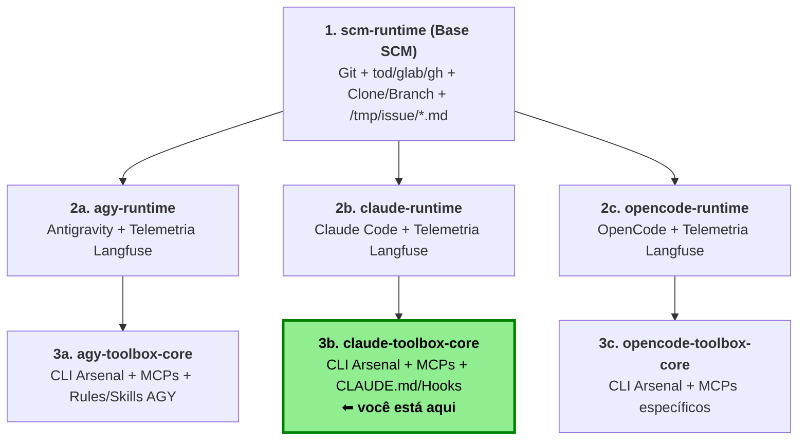

# claude-toolbox-core

Camada 3 da família `*-runtime` / `*-toolbox`: uma imagem efêmera que sobe com o repositório Git clonado e o Claude Code rodando dentro, munido de um arsenal de CLI de linha de comando para trabalhar nesse repositório.

O `Dockerfile` desta camada é curto de propósito — ele **herda** `claude-runtime` (camada 2), que por sua vez herda `scm-runtime` (camada 1) — e adiciona apenas o que é específico do toolbox: pacotes de sistema, ferramentas via `mise` e a política gerenciada do Claude Code.

| Camada   | Repo                         | O que traz                                                                                                         |
|----------|------------------------------|--------------------------------------------------------------------------------------------------------------------|
| 1        | `scm-runtime`                | entrypoint: valida env, configura git, clona o repo, baixa a issue, monta `/tmp/repo` e `/tmp/issue`               |
| 2        | `claude-runtime`             | `claude-start.sh` (CMD), Claude Code via `mise`, plugin Langfuse, contexto em `~/.claude/rules/runtime-context.md` |
| 3        | `claude-toolbox-core` (esta) | arsenal de CLI (`mise`), utilitários de sistema, `managed-settings.json`                                           |

Detalhes de implementação das camadas base ficam nos repos delas (ver [Camadas base](#camadas-base)); aqui só está o que esta camada acrescenta.

---

## O que esta camada adiciona

### 1. Utilitários de sistema (apt)

Pacotes instalados sobre a base, como `root`, em uma única etapa:

| Grupo                | Pacotes                                                                 |
|----------------------|-------------------------------------------------------------------------|
| Shell e completion   | `bash`, `bash-completion`, `gnupg`                                      |
| Arquivos e navegação | `findutils`, `file`, `less`, `tree`                                     |
| Texto e diff         | `grep`, `sed`, `gawk`, `diffutils`, `patch`, `xxd`                      |
| Compactação          | `tar`, `gzip`, `bzip2`, `xz-utils`, `zstd`, `zip`, `unzip`              |
| Extras               | `procps` (`ps`), `bc`, `gettext-base` (`envsubst`), `nano`, `vim`       |
| Locale e runtime     | `locales`, `tzdata`, `tini` (disponível para envolver processos filhos) |

A imagem segue sem `root` no uso: o `USER` volta a `agent` (uid 1000) antes de copiar o `rootfs/home/agent/`, e o `apt` roda só durante o build.

### 2. Arsenal de CLI (mise)

As ferramentas entram pelo `mise`, em `rootfs/home/agent/.config/mise/conf.d/30-toolbox.toml`, com versão fixa (build reprodutível). O nome `30-` garante que o arquivo seja mesclado **depois** dos das camadas base (`10-scm.toml` e `20-claude.toml`).

```toml
[tools]
python = "3.14.8"
ripgrep = "15.2.0"
fd = "10.5.0"
yq = "4.54.1"
docker-cli = "29.8.2"
"aqua:docker/buildx" = "0.37.2"
ast-grep = "0.45.3"
shellcheck = "0.11.0"
shfmt = "3.14.1"
difftastic = "0.71.0"
delta = "0.20.1"
```

| Ferramenta | Comando | Para quê |
|---|---|---|
| ripgrep | `rg` | busca textual rápida, alternativa ao `grep` |
| fd | `fd` | busca de arquivos, alternativa ao `find` |
| ast-grep | `ast-grep` | busca e reescrita por sintaxe (não por texto) |
| yq | `yq` | manipulação de YAML |
| difftastic | `difft` | diff semântico, por árvore sintática |
| delta | `delta` | diff com cores e side-by-side |
| shellcheck | `shellcheck` | análise estática de shell script |
| shfmt | `shfmt` | formatação de shell script |
| docker-cli + buildx | `docker`, `docker buildx` | CLI do Docker (build/push de imagens) |
| python | `python` | runtime Python 3.14 |

Junto vêm duas env vars de build:

- `MISE_YES=1` — instala sem perguntar nada (build não interativo);
- `MISE_IDIOMATIC_VERSION_FILE_ENABLE_TOOLS=node,python` — permite que um arquivo de versão no repo clonado (`.mise.toml`, `.tool-versions`, `.node-version`…) fixe a versão de node/python usada na sessão.

Detalhe importante: o `docker` é **só a CLI**. Não há daemon no container; para usar `docker` de fato é preciso apontar para um daemon externo com `DOCKER_HOST`.

O mise já instalado na base traz o resto do arsenal — `claude`, `uv` (camada 2) e `glab`, `gh`, `tod` (camada 1) — além do `jq` que vem de `apt` na camada 1. A lista completa, já validada dentro do container, está em [`AGENTS.md`](AGENTS.md).

### 3. Política gerenciada do Claude Code

`rootfs/etc/claude-code/managed-settings.json` é aplicado pelo Claude Code como configuração gerenciada do sistema (padrão do path `/etc/claude-code/managed-settings.json`) e não pode ser sobreposto por settings do usuário ou do projeto:

```json
{
  "attribution": {
    "commit": ""
  },
  "permissions": {
    "deny": [
      "Bash(git commit --no-verify *)",
      "Bash(git commit -n *)",
      "Bash(git * --no-verify *)",
      "Bash(git -c core.hooksPath*)",
      "Bash(git config * core.hooksPath*)"
    ]
  }
}
```

Ou seja:

- **sem atribuição de commit** — o Claude não adiciona trailer de co-authored-by automaticamente (o trailer do `GIT_CO_AUTHOR` continua vindo do hook `prepare-commit-msg` da camada 1);
- **bloqueio de `--no-verify`** — não dá para furar hooks de commit;
- **bloqueio de mexer em `core.hooksPath`** — não dá para apontar os hooks para outro lugar (o que burlaria o hook de co-author).

---

## Build

```bash
docker build -t claude-toolbox-core:latest .
docker run --rm -it --env-file ./.env/meurepo claude-toolbox-core:latest
```

## Uso

O entrypoint (camada 1) valida as variáveis, configura o git e a CLI da forja, clona o repo em `/workspace` e faz checkout da branch de trabalho; depois o `CMD` (`claude-start.sh`, camada 2) inicia o Claude Code.

```bash
docker run --rm -it --env-file ./.env/meurepo claude-toolbox-core:latest
```

Trabalhando numa issue (o contexto é baixado e entregue ao Claude):

```bash
docker run --rm -it --env-file ./.env/meurepo \
  --env ISSUE_ID=123 \
  claude-toolbox-core:latest
```

Modo autônomo (não interativo, resolve a issue e sai):

```bash
docker run --rm --env-file ./.env/meurepo \
  --env ISSUE_ID=123 \
  --env AUTONOMOUS_MODE=true \
  claude-toolbox-core:latest
```

Para inspecionar a imagem sem iniciar o Claude (o entrypoint ainda clona o repo e configura o git):

```bash
docker run -d --name toolbox --env-file ./.env/meurepo claude-toolbox-core:latest sleep infinity
docker exec -it toolbox bash
```

### Exemplo de `.env/meurepo`

`GIT_SERVER_TYPE`, `GIT_REPO_URL`, `GIT_TOKEN`, `GIT_BASE_BRANCH`, `GIT_USER_NAME` e `GIT_USER_EMAIL` são obrigatórios. Exemplos reais (descartáveis) em `.env/demo-test-*.env`.

> No `--env-file` do Docker, não use aspas nem `export` (o valor é lido literalmente) e mantenha comentários apenas em linhas próprias (no fim da linha viram parte do valor).

```dotenv
# ==============================================================================
# Camada 1: Repositório Git e Issue (scm-runtime)
# ==============================================================================

# Tipo da forja: onedev, gitlab ou github (obrigatório)
GIT_SERVER_TYPE=onedev

# URL HTTP/HTTPS do repositório a ser clonado em /workspace (obrigatório)
GIT_REPO_URL=http://onedev.example.com/org/repo.git

# Token de acesso pessoal (PAT / Access Token) da forja (obrigatório; fica só em memória)
GIT_TOKEN=<token da forja>

# (Opcional) Usuário no credential helper HTTP (padrão: git)
GIT_USERNAME=git

# Branch base clonada inicialmente do remoto (obrigatório)
GIT_BASE_BRANCH=main

# Branch de trabalho (obrigatória se ISSUE_ID não estiver definido; criada a partir de GIT_BASE_BRANCH se não existir)
GIT_BRANCH=agent/minha-tarefa

# Identidade Git configurada no container para os commits (obrigatório)
GIT_USER_NAME=MyAgent
GIT_USER_EMAIL=myagent@example.com

# (Opcional) Co-autor humano adicionado automaticamente via hook prepare-commit-msg (formato: "Nome <email>")
GIT_CO_AUTHOR=Some human <somehuman@example.com>

# (Opcional) ID da issue a ser baixada para /tmp/issue/*.md (sobrescreve GIT_BRANCH para issue/<ISSUE_ID>)
#ISSUE_ID=123

# (Opcional) Modo autônomo: se true, executa sem interação humana, captura stdout e comenta na issue (exige ISSUE_ID)
#AUTONOMOUS_MODE=true

# (Opcional) Limite máximo de caracteres do stdout enviado como comentário na issue no modo autônomo (padrão: 60000)
#MAX_COMMENT_CHARS=60000

# (Opcional) Overrides de host/token para GitLab ou GitHub Enterprise (derivados de GIT_REPO_URL e GIT_TOKEN se omitidos)
#GITLAB_HOST=https://gitlab.example.com
#GITLAB_TOKEN=seu_token_gitlab
#GH_HOST=github.example.com
#GH_TOKEN=seu_token_github
#GH_ENTERPRISE_TOKEN=seu_token_ghe

# ==============================================================================
# Camada 2: Claude Code — Autenticação e Runtime (claude-runtime)
# ==============================================================================

# Autenticação (escolha uma das opções abaixo):
# Opção A) Assinatura Claude (OAuth token)
CLAUDE_CODE_OAUTH_TOKEN=sk-ant-...

# Opção B) Provedor compatível com a API Anthropic (ex.: Ollama, LiteLLM, vLLM)
#ANTHROPIC_BASE_URL=https://ollama.com
#ANTHROPIC_AUTH_TOKEN=<token do provedor>
#CLAUDE_CODE_MAX_CONTEXT_TOKENS=128000
#CLAUDE_CODE_ATTRIBUTION_HEADER=0

# (Opcional) Modelo passado para `claude --model`
#MODEL=gpt-oss:20b

# (Opcional) Prompt inicial enviado ao Claude Code (padrão autônomo com ISSUE_ID: "Resolva a issue #<ID>.")
#ISSUE_PROMPT=Resolva a issue

# (Opcional) Se true, inclui os comentários da issue (/tmp/issue/comments.md) no contexto do agente
#ISSUE_COMMENTS=true

# ==============================================================================
# Camada 2: Telemetria Langfuse (plugin langfuse-observability)
# ==============================================================================

# (Opcional) URL base e chaves do projeto no Langfuse (se omitidas, nenhum trace é enviado)
LANGFUSE_PUBLIC_KEY=pk-lf-...
LANGFUSE_SECRET_KEY=sk-lf-...
LANGFUSE_BASE_URL=http://langfuse.example.com

# (Opcional) Identificador do usuário no trace (fallback automático: e-mail de GIT_CO_AUTHOR -> GIT_USER_EMAIL)
#LANGFUSE_USER_ID=some-user

# ==============================================================================
# Camada 3: Docker CLI (claude-toolbox-core)
# ==============================================================================

# (Opcional) Endpoint do daemon Docker externo (a imagem traz apenas o docker-cli/buildx, sem daemon interno)
#DOCKER_HOST=unix:///var/run/docker.sock
```

### Variáveis

| Variável                                                                    | Camada     | Efeito                                                                                                                                 |
|-----------------------------------------------------------------------------|------------|----------------------------------------------------------------------------------------------------------------------------------------|
| `GIT_SERVER_TYPE`                                                           | scm        | `onedev`, `gitlab` ou `github`; escolhe a CLI (`tod`, `glab`, `gh`) e os templates                                                     |
| `GIT_REPO_URL`                                                              | scm        | URL `http(s)` do repo; dela saem servidor e caminho do projeto                                                                         |
| `GIT_TOKEN`                                                                 | scm        | token da forja; usado pelo git e pela CLI, fica só no ambiente (nunca em disco)                                                        |
| `GIT_BRANCH`                                                                | scm        | branch de trabalho; obrigatória se não houver `ISSUE_ID`                                                                               |
| `ISSUE_ID`                                                                  | scm        | baixa a issue e sobrescreve `GIT_BRANCH` com `issue/<ISSUE_ID>`                                                                        |
| `AUTONOMOUS_MODE`                                                           | scm/claude | `true` roda `claude -p --dangerously-skip-permissions`; exige `ISSUE_ID` (ou `ISSUE_PROMPT`) e aborta se a issue não puder ser baixada |
| `GITLAB_HOST`, `GITLAB_TOKEN`, `GH_HOST`, `GH_TOKEN`, `GH_ENTERPRISE_TOKEN` | scm        | opcionais; derivados de `GIT_REPO_URL`/`GIT_TOKEN` quando ausentes                                                                     |
| `ISSUE_PROMPT`                                                              | claude     | prompt inicial (padrão com `ISSUE_ID`: "Resolva a issue #ID.")                                                                         |
| `ISSUE_COMMENTS`                                                            | claude     | `true` inclui `comments.md` no contexto                                                                                                |
| `MODEL`                                                                     | claude     | modelo passado a `claude --model`                                                                                                      |

---

## Contexto entregue ao Claude (herdado)

Markdowns gerados no container e injetados no contexto do agente:

| Arquivo                  | Conteúdo                                                   | Quando         |
|--------------------------|------------------------------------------------------------|----------------|
| `/tmp/repo/repo.md`      | forja, servidor, URL, projeto, branch base e de trabalho   | sempre         |
| `/tmp/repo/cli.md`       | exemplos de comandos da CLI da forja (`tod`, `glab`, `gh`) | sempre         |
| `/tmp/issue/issue.md`    | título, estado, autor, labels, descrição da issue          | com `ISSUE_ID` |
| `/tmp/issue/comments.md` | comentários da issue em ordem cronológica                  | com `ISSUE_ID` |

Os `.json` originais da issue ficam em `/tmp/issue/`. O `claude-start.sh` concatena `repo.md`, `cli.md`, `issue.md` (e `comments.md` com `ISSUE_COMMENTS=true`) em `~/.claude/rules/runtime-context.md`, deixando o `CLAUDE.md` livre para o toolbox.

## Langfuse (herdado)

Plugin oficial [`langfuse-observability`](https://github.com/langfuse/Claude-Observability-Plugin) instalado no build (hooks `Stop`/`SessionEnd`, via `uv`). As chaves `LANGFUSE_*` vêm do env em runtime; sem elas o hook não envia nada.

### Tags do trace

O `claude-start.sh` exporta `CC_LANGFUSE_TRACE_TAGS` antes de iniciar o Claude, e o plugin aplica essas tags a cada trace. Servem para filtrar uso e custo no Langfuse por execução, issue ou pessoa.

| Tag        | Valor                                                     | Origem                                                                           |
|------------|-----------------------------------------------------------|----------------------------------------------------------------------------------|
| `mode`     | `autonomous` ou `interactive`                             | `AUTONOMOUS_MODE`                                                                |

---

## Camadas base

A implementação do entrypoint, do `claude-start.sh` e da geração dos markdowns vive nas camadas base. Para inspecionar de fato (em vez de deduzir pelo README), clone os repos correspondentes:

```bash
git clone http://onedev.uaiso.duckdns.org/scm-runtime.git /tmp/scm-runtime
git clone http://onedev.uaiso.duckdns.org/claude-runtime.git /tmp/claude-runtime
```
